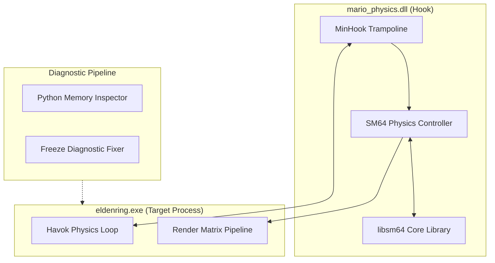

<div align="right">
  <strong>English</strong> | <a href="README.pt-BR.md">Português</a>
</div>

# Mario Physics Hook (Elden Ring Native C++ Mod Engine) 🎮🔧

[]()
[]()
[](https://github.com/TsudaKageyu/minhook)
[](https://github.com/libsm64/libsm64)
[](LICENSE)

> **Low-Level Native Memory Hook & Physics Engine Bridge for Elden Ring.**  
> Intercepts process memory and physics tick routines via x86_64 detours, embedding the authentic Super Mario 64 physics engine (`libsm64`) directly into the AAA game executable runtime.

---

## 📌 Architectural Flow (Memory Hooking & Detours)

The DLL hook hijacks the game loop via MinHook trampoline detours, updates SM64 Mario physics ticks, and maps the transformed transformations directly into Elden Ring's Havok character controller memory.



---

## ⚙️ Core Engineering Achievements

### 1. Zero-Crash In-Memory Detours via MinHook
- Intercepts player kinematics routines without corrupting the surrounding Havok physics thread or triggering runtime stack guard exceptions.
- Restores original bytecode execution via trampolines on clean shutdown.

### 2. Multi-Rate Physics Tick Synchronization
- Resolves tick rate mismatch between SM64's fixed 30Hz simulation loop and Elden Ring's 60Hz physics clock using linear interpolation and velocity accumulator queues.

### 3. Collision Mesh Surface Injection
- Queries Elden Ring's Havok static geometry collision trees and translates triangles into SM64 collision surfaces dynamically in memory.

---

## 🛠️ Build & Compilation

### Requirements
- MSVC v143 or higher (Visual Studio 2022 C++ Build Tools)
- Windows SDK 10.0+ (x86_64)

```bash
# Compile native DLL
build.bat
# Output: bin/mario_physics.dll
```

---

## ⚖️ Legal & Ethical Notice
*This software is a clean-room open-source educational reverse engineering modding tool. It does not distribute or contain proprietary FromSoftware game assets, copyrighted models, or ROM data.*
