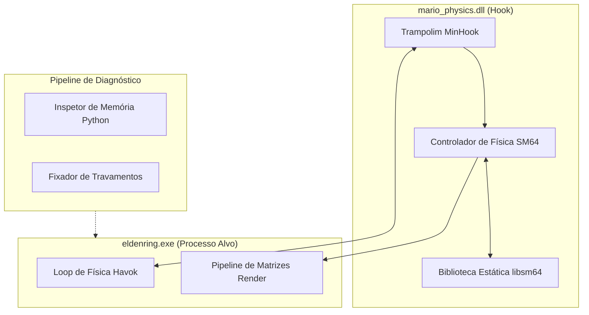

<div align="right">
  <a href="README.md">English</a> | <strong>Português</strong>
</div>

# Mario Physics Hook (Motor de Modding Nativo C++ para Elden Ring) 🎮🔧

[]()
[]()
[](https://github.com/TsudaKageyu/minhook)
[](https://github.com/libsm64/libsm64)
[](LICENSE)

> **Hook Nativo de Memória e Ponte de Física em C++ para Elden Ring.**  
> Intercepta a memória do processo e as rotinas de tick de física do jogo via detours x86_64, embutindo o motor de física autêntico do Super Mario 64 (`libsm64`) diretamente no runtime do executável AAA.

---

## 📌 Fluxo Arquitetural (Hooking de Memória & Detours)

A DLL intercepta o loop do jogo por trampolins com MinHook, processa os ticks da física do SM64 e projeta as transformações calculadas diretamente na memória do controlador de personagens Havok do Elden Ring.



---

## ⚙️ Conquistas Centrais de Engenharia

### 1. Detours em Memória sem Travamentos via MinHook
- Intercepta as rotinas de cinemática do jogador sem corromper as threads paralelas da engine Havok nem acionar proteções de pilha do compilador.
- Restaura a execução original do código de máquina através de trampolins limpos no encerramento.

### 2. Sincronização de Frequência de Ticks Diferentes
- Resolve a divergência entre a simulação de 30Hz do SM64 e o clock de física de 60Hz do Elden Ring utilizando interpolação linear e filas acumuladoras de velocidade.

### 3. Injeção Dinâmica de Superfícies de Colisão
- Lê as árvores de geometria estática da engine e injeta os triângulos como superfícies de colisão dinâmicas na memória do SM64 em tempo real.

---

## 🛠️ Compilação

### Requisitos
- Ferramentas de compilação C++ MSVC v143 ou superior (Visual Studio 2022)
- Windows SDK 10.0+ (x86_64)

```bash
# Compilar a DLL nativa
build.bat
# Saída: bin/mario_physics.dll
```

---

## ⚖️ Aviso Legal & Uso Educacional
*Este projeto é uma ferramenta educacional independente de engenharia reversa e modding em ambiente limpo (*clean-room*). Não distribui nem contém arquivos proprietários da FromSoftware, modelos protegidos ou ROMs de jogos.*
